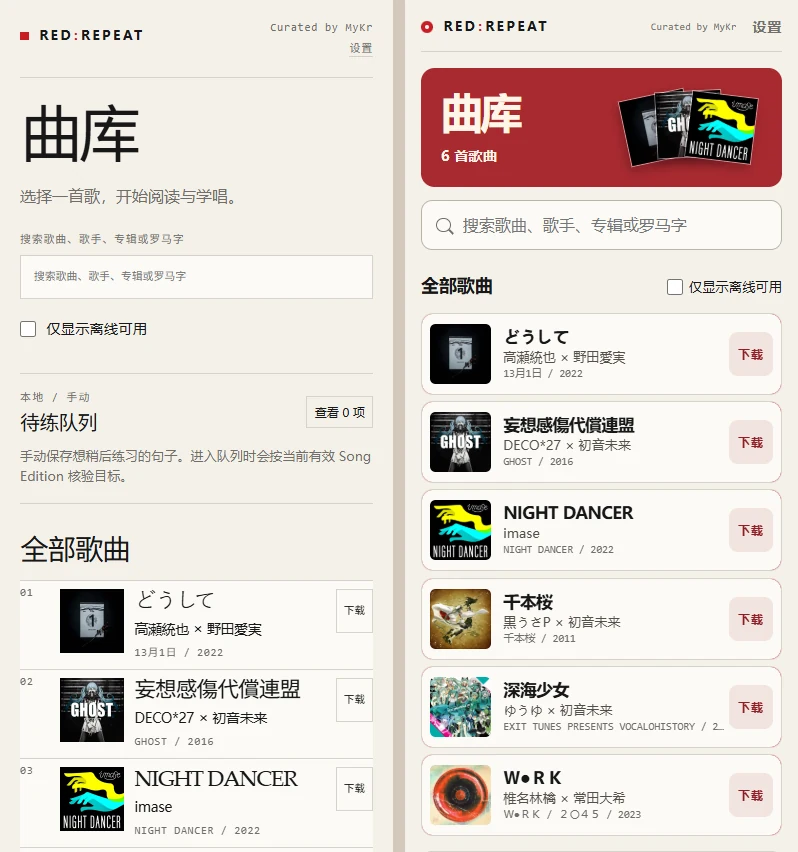
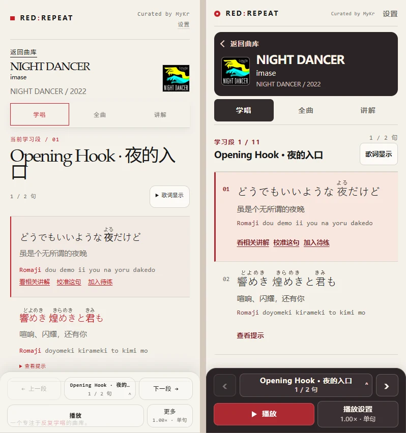
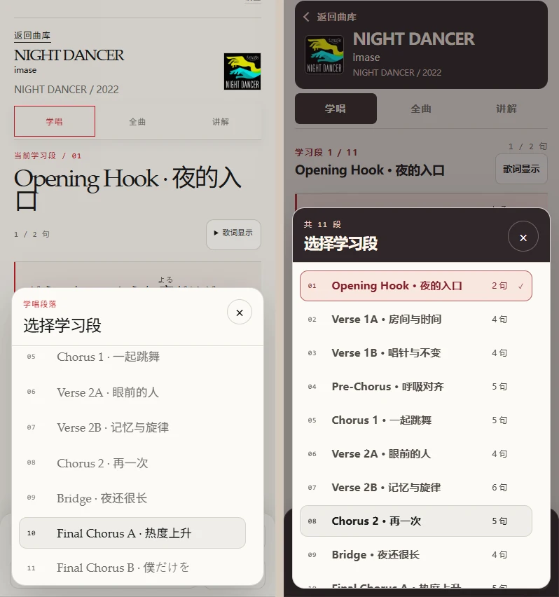

# 手机曲库与学唱候选对照

每张图左侧为已发布的 **1.29.1**（build `381f815cf803`），右侧为 **1.30.0 候选**（元数据 build `e481906e626f`，产品提交 `3ff793e`）。使用同一份六曲源、Windows Edge 158.0.4370.33 和独立浏览器上下文。普通视口 393 × 852 CSS px。输入态收短至 393 × 530，用于观察可用高度变化。截图记录桌面浏览器渲染，iOS 输入法、Safari 工具栏和系统字体需用目标设备观察。

## 从找歌到开始学唱

基线先显示说明、搜索、筛选和待练队列，第一首歌的入口顶边在 581 px。候选将待练和最近学习移到歌曲列表下，第一首歌从 321 px 开始。封面沿用对应歌曲资源。搜索时收起封面区域，将匹配结果放到手边。在短视口输入 NIGHT 后，第一条匹配的入口从 581 px 移至 226 px。独立下载按钮的实测区域从约 37 × 44 增至 44 × 44 px。[搜索输入](input.webp) · [完整搜索结果](result.webp)

NIGHT DANCER 首句的可点区域顶边从 446 px 移至 354 px，高度从约 34 px 增至 44 px。专辑封面和歌曲身份共用页首，学习段标题与歌词设置并排。原文、Ruby、译文和 Romaji 各有排版，左侧句号与色带标出当前句。主要播放键采用实色，底部保留选段和播放设置。切换显示偏好、选句和播放均沿用现有数据与音频会话。[辅助层全开及大字号](layers.webp) · [展开播放设置](controls.webp)

选段面板列出各段句数和当前项，列表单独滚动。关闭后焦点回到选段按钮。手机上可通过实时测量的播放器高度留出末句空间。

## iPhone 14 Pro 验收

同一 WLAN 的候选地址随交付回执提供。打开后在设置核对版本 1.30.0 和回执所列 build。记录 iOS 版本及构建号、Safari 或主屏幕入口、文字大小和减少动态效果设置。

1. 搜索 NIGHT DANCER，观察键盘出现、清除和收起时的结果位置。点歌进入学唱。
2. 试听首段第二句（`p001/o002/s002`）；选第 9 段试听较长的 `o037/s029`。开关翻译、Romaji、大字号，观察 Ruby 与原文、当前句及滚动位置。
3. 第 10 段「又相信了『大丈夫』」属于另一首《妄想感傷代償連盟》。在该段末句 `p010/o036/s036` 检查四处 Ruby，展开、收起播放设置，打开、滑动并关闭选段面板，确认末句操作和底部控件都触得到。
4. 用「返回曲库」和 Safari 历史返回各走一次。核对原查询、原歌曲位置、键盘与旧歌暂停，再进入另一首。观察工具栏伸缩、顶部安全区与 Home 指示区。
5. 在支持离线的验收入口下载歌曲并开启离线筛选。返回时若显示「正在核验离线状态」，更换搜索词或滑动页面，检查结果出现后是否以当前操作为准。再返回一次并等待核验，检查原歌曲位置。

局域网 HTTP 用于布局与播放检查，完整下载、Service Worker 和主屏幕离线需安全 origin。候选已在 localhost 完成下载断网回归。用户实际手机、原生触摸、听感和主屏幕运行方式待反馈。实际 PR、验收回执与设备反馈统一记录在 [RED-Plan-95](https://github.com/MyKr-YSteinsK/red-repeat/issues/5)。
