# 全曲与讲解的手机体验对照

左列为线上 1.30.0 对应的 `a3600ff679bf` 本地构建，右列为 1.31.0 候选构建
`abc1487a086c`，产品提交 `2265cef`。两次在 Windows Edge 158.0.4370.33 使用同一份
六曲数据、相同的操作与视口、减少动态效果设置。尺寸为 CSS px。实际 iPhone 14 Pro 与主屏幕 PWA
体验按 Plan 延期集中记录。移动浏览器截图均来自桌面代理环境。

## 全曲

| 截图状态 | 1.30.0 | 1.31.0 候选 |
| --- | --- | --- |
| NIGHT DANCER 首句播放，393 × 852 | 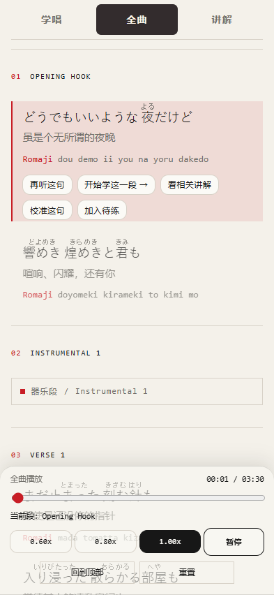 | 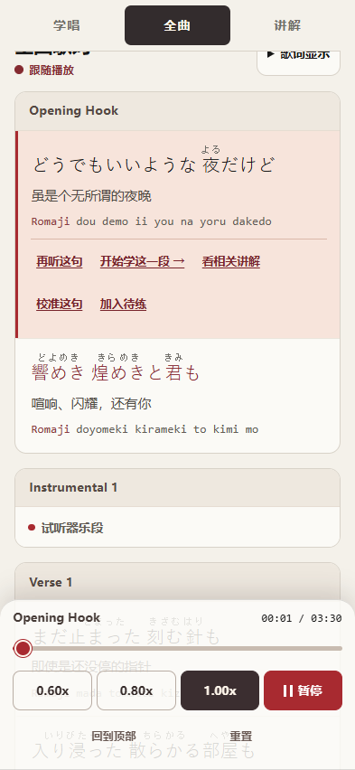 |
| NIGHT DANCER 自由浏览，393 × 570 | 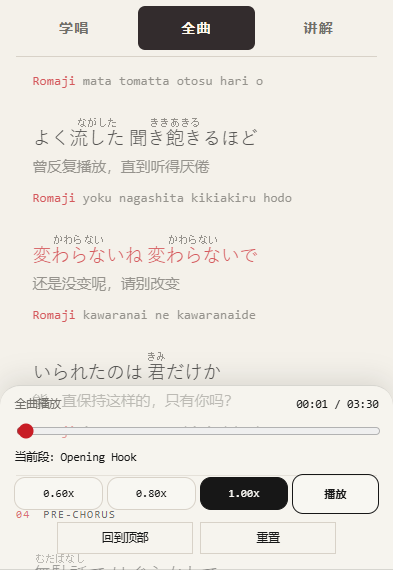 | 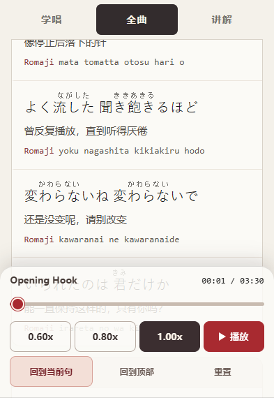 |
| NIGHT DANCER 拖动中，393 × 570 | 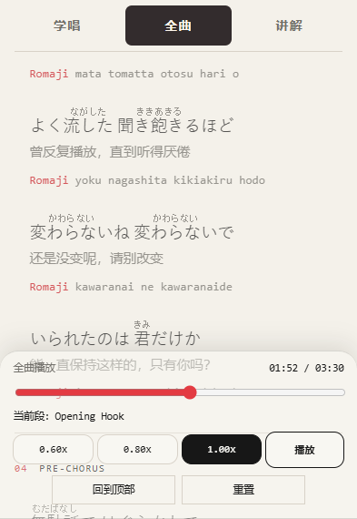 | 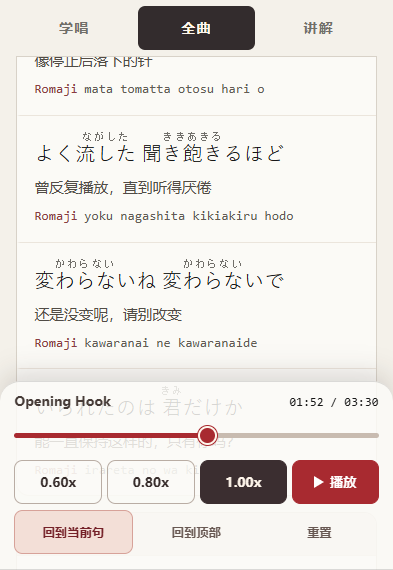 |
| 妄想感傷代償連盟 `o036/s036`，四处 Ruby，393 × 852 | 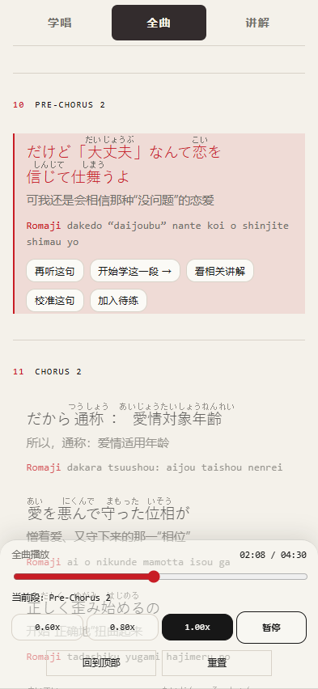 | 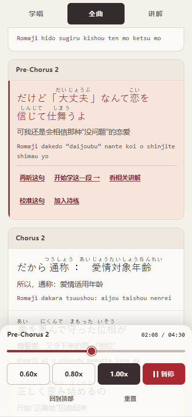 |

歌词按段落成组，淡色卡片和行边色带显示当前句，阅读层各有间距。播放器保留通宽贴底的几何形态。
材质的表面不透明度从 38% 调到 84%，配合 10 px 模糊，滚动文字经过底栏时更容易看清时间与控件。
段名与时间并排后，给进度控件留出更高的触达区域（16 → 38 px），播放键从 40 增至 44 px。
这组截图中底栏高约 185 → 189 px。短视口底栏顶部约在 381 px，通过实测底栏高度预留滚动空间，
确保末句可完整滚到底栏上方。自由浏览时可从底栏回到当前句，拖动时先显示目标时间，松手提交。

## 讲解

| 截图状态 | 1.30.0 | 1.31.0 候选 |
| --- | --- | --- |
| NIGHT DANCER 长文，393 × 852 |  |  |
| NIGHT DANCER 展开目录，393 × 852 | 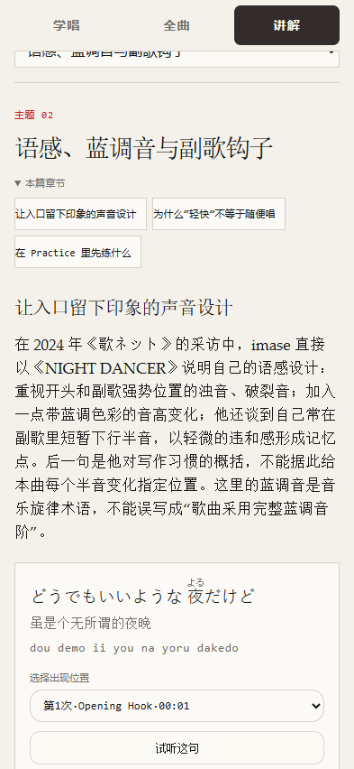 | 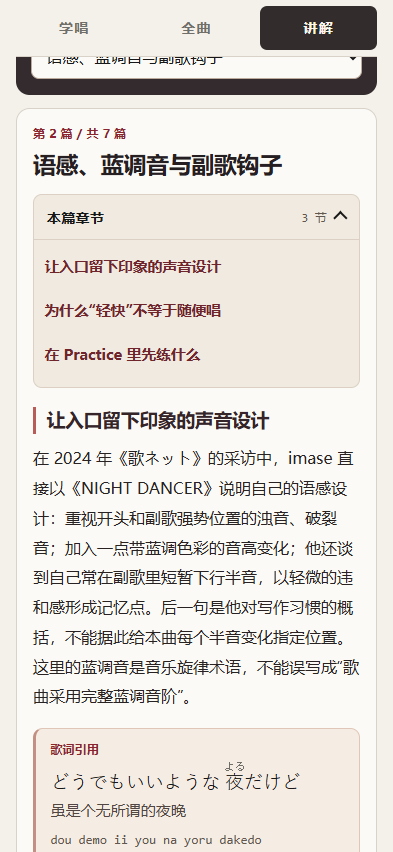 |
| 妄想感傷代償連盟 `o036` 正在试听，393 × 852 | 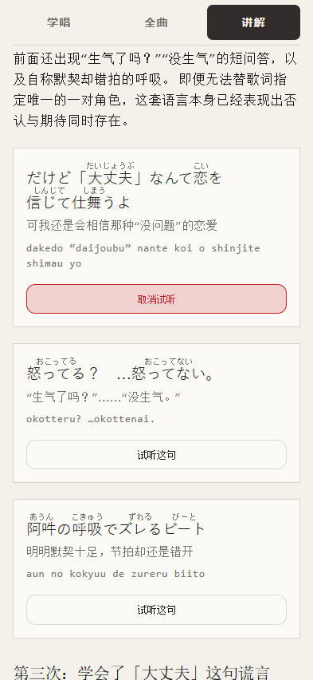 | 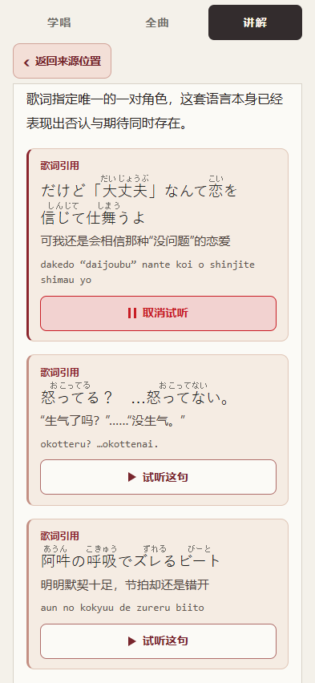 |
| 同一句从全曲进入讲解后就位，393 × 852 | 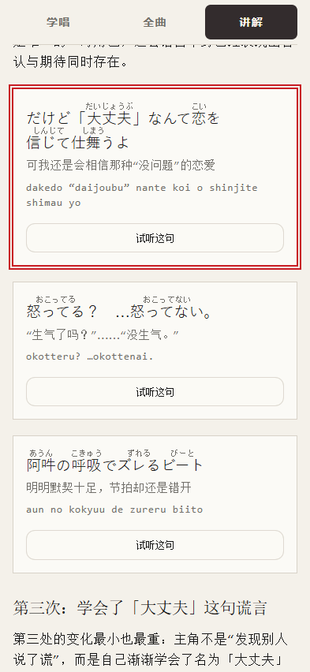 | 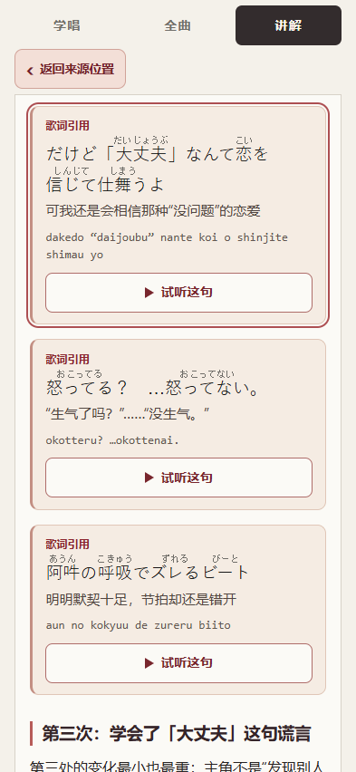 |

NIGHT DANCER 长文及目录来自 `02-语感蓝调音与副歌钩子`，妄想感傷代償連盟的试听来自
`03-三个大丈夫如何把恋爱写成自我欺骗`。主题选择、正文和歌词引用有独立层级。目录选中后收起，把焦点移到
所选标题。翻页将阅读位置移到新文章顶部。从歌词进入讲解时，来源按钮随模式栏停留，移动端此状态的工具栏
约增加 48 px，相关引用和目录跳转按工具栏实高避让。返回恢复原句位置与控制焦点，试听沿用同一播放会话。

## 后续真机观察

在 iPhone 14 Pro 的 Safari 与主屏幕入口记录系统版本、文字大小和减少动态效果设置。听 NIGHT DANCER，
在全曲拖动进度、滚动到最后一句并回到当前句，观察工具栏伸缩及横屏时的底栏。播放妄想感傷代償連盟的
`o036`，由相关讲解试听、取消并返回，核对 Ruby、原句位置和听感。常规体验检查随后续数轮改造集中收集。
实际候选入口、工程验收和反馈记录归在 [RED-Plan-96](https://github.com/MyKr-YSteinsK/red-repeat/issues/7)。
