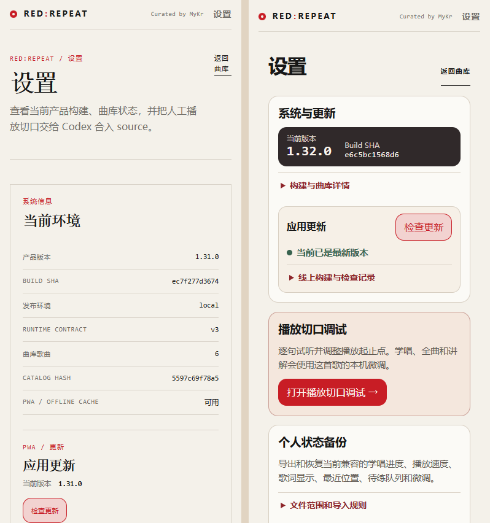
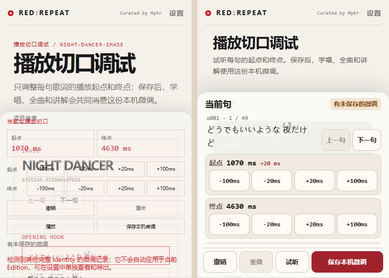

# 设置与播放切口调试的手机对照

左侧为已发布 1.31.0 的 `ec7f277d3674` 本地构建，右侧为 1.32.0 候选 `e6c5bc1568d6`。
两次均用 Windows Edge 158.0.4370.33、同一六曲资源、隔离浏览器状态和减少动态效果设置。
常规视口 393 × 852，备份预览与确认、调试编辑／错误／保存使用 393 × 570。尺寸单位为 CSS px。
对照中的备份、历史 Timing 记录和远端版本 `9.0.0` 均为合成样本。

## 设置与更新

当前版本与 Build SHA 在首屏一起显示。应用更新用独立状态区区分正在准备、等待下次打开和检查失败。
在 393 × 852 下，更新区顶边从约 700 px 移到 336 px。构建详情、线上检查记录与完整历史按需展开。日志深链定位到原有分组。后台检查与自然接管沿用同一更新流程。
[正在准备及远端更新说明](update-available.webp) · [检查失败与重试](update-error.webp) · [Worker 等待接管](update-waiting.webp) · [版本日志深链](changelog.webp)

## 个人备份和 Timing 归档

选文件后显示文件名、生成时间和每个数据域的新增、相同、冲突与跳过数量。预览时可用键盘选中数据域，
确认前单独决定是否覆盖，底部汇总实际将写入的范围。取消后可重新选文件。部分写入失败的回滚与读回沿用
原事务。Timing 历史独立导出，兼容判断使用现有完整身份。长 Timeline 路径可在窄屏换行。
[导入预览](backup-preview.webp) · [旧身份 Timing 归档](archive.webp)

## 逐句试听和微调

调试台保留通宽贴底的控制台，调整区和歌词列表可独立滚动。控制台表面从 38% 提到 95% 不透明度，
并使用 12 px 模糊，以减轻歌词经过底栏时的文字重叠。选择相邻句时同步定位歌词，选中的原文和 Ruby
与起止点一起显示，改过的值在旁边标出相对原始时间的差值。试听、撤销重做和保存位于稳定的操作行。
在 393 × 570 的编辑状态，调节与保存按键从 32 px 增至 44 px，底栏约从 342 px 增至 382 px。调整区内部滚动，保留整行主操作。保存中保留草稿，收到结果后分别呈现成功、冲突或失败。
[歌曲选择](songs.webp) · [调试待操作](timing-ready.webp) · [无效句子链接](timing-error.webp) · [保存确认](timing-save.webp)

## 验收与后续观察

用同一组合成输入得到一致的单域覆盖结果、旧身份归档 JSON 和有效 Timing 文档。Edge 实测在准备好
等待接管的 Worker 时保留当前页面，并验证试听实际范围、失败后的回滚、保存读回和返回曲库。
Windows WebKit 26.5 覆盖长文件名、长 ID、键盘选择、大字号、320 px 窄屏、430 px 短屏、横屏和底栏滚动。

iPhone 14 Pro Safari 和主屏幕 PWA 的常规体验集中观察。记录打开方式、系统版本、工具栏变化和文字大小。
重点看原生文件选择、短屏的确认区，以及调整末句时底部安全区与手感。完整验收记录归在
[RED-Plan-97](https://github.com/MyKr-YSteinsK/red-repeat/issues/9)。
