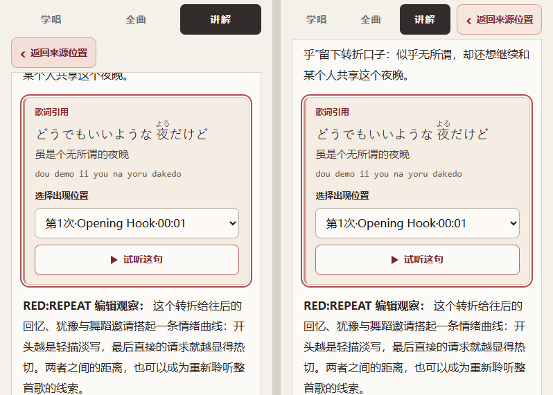
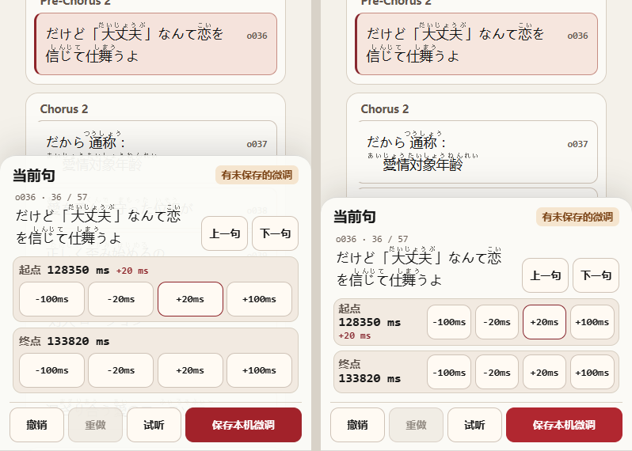

# 跨页阅读与播放对照

左图是已发布的 1.32.0（`eb42e35e6a38`），右图是 1.32.1 PATCH 候选（`b314e4899f8d`，产品提交 `7c5521c`）。同一台 Windows 机器、Edge 158.0.4370.33、相同歌曲、所选句和视口。本轮调整已有操作，iPhone 14 Pro Safari 与主屏幕 PWA 的日常体验按约留给集中使用阶段。

## 两处腾出的歌词空间

**从歌词进入讲解**。在 393×570 的 NIGHT DANCER 引用页，返回键与三个模式键可以排在一行，固定栏从 105.2 px 降至 57.2 px。320 px 配合大字号时自动分行。点击返回后焦点和阅读位置回到来源歌词，试听和返回沿用同一播放会话。



**短屏微调**。《妄想感傷代償連盟》o036 起点加 20 ms 后，相同视口的底栏从 374.2 px 降至 321.3 px，多露出 52.9 px 歌词。起止值紧邻各自的一组按钮，保存键仍高 44 px。较窄或放大文字后，标签可回到按钮上方，调整区可以独立滚动。实色底板让正在调整的数字与背后的歌词分开。



曲库下载、学唱选中句、全曲播放和设置保存共享红色操作与浅色选中提示。设置增加当前页标识，设置与调试的返回键沿用歌曲页的箭头和触摸高度。学唱保留深色播放栏，全曲底栏提高底色覆盖率，调试底栏采用不透明纸色。其余截图为 393×852。[曲库](catalog.webp) · [学唱](practice.webp) · [全曲](full.webp) · [讲解](explain.webp) · [设置](settings.webp)

## 哪一段操作变快了

全曲原本会在选句、开始播放和暂停时给每一行重新绑定元素。现在每行使用稳定的引用，只在本行活动、选中、内容、阅读偏好或回调发生变化时更新。重叠演唱的主次高亮、移出屏幕的歌词、Ruby 与当前句操作仍各自生效。定向用例在 1.32.0 上复现了无关歌词行重新计算读音层，在候选上通过。

| 实际测量 | 1.32.0 中位 / P90 | 1.32.1 中位 / P90 |
| --- | ---: | ---: |
| NIGHT DANCER 依次选播并暂停四句，重新登记的歌词行次数 | 588 / 588 | 0 / 0 |
| 《妄想感傷代償連盟》四次选播和暂停，脚本执行累计 ms | 174.5 / 189.5 | 100.3 / 137.0 |
| 同组点击到选中行和暂停按钮可见的反馈 ms | 80.2 / 84.8 | 70.1 / 84.3 |
| 冷开曲库到搜索框就绪 ms | 1160 / 2178 | 1091 / 1324 |
| 搜索 NIGHT DANCER 后点击到学唱歌词 ms | 699 / 1369 | 693 / 971 |
| 同曲首次热重开 ms | 135 / 253 | 188 / 261 |
| 点击设置到设置内容就绪 ms | 982 / 1585 | 995 / 1494 |

每版 10 轮。曲库流程用独立新 profile，模拟 4 倍 CPU 降速、25 ms 网络延迟、下载 1.5 MB/s，固定 `/red-repeat/`。这里关闭 Worker 以控制网络路径，下载后的真实断网流程单独验收。搜索框就绪按 DOM 出现记录，歌词与设置反馈等到目标元素出现并经过两次动画帧回调。全曲专测在本机网络、预热同一首歌后进行，每轮选择 o033、o036、o037、o040。表中的点击反馈先取每轮四句的中位数，P90 为十轮中的第九个顺序值。该指标测的是界面反馈。

同曲热重开的分组样本波动较大。补充实验用同一浏览器打开两个本地产物，各预热一次后交替先后顺序，每版 20 次。点击歌曲到歌词可见的中位数为 188.4 → 179.7 ms，P90 为 204.7 → 203.6 ms。本轮保留原来的进入与请求策略。

整段流程每轮均记录到 34 个资源请求，Resource Timing 的传输字节中位数为 5,991,941 → 5,994,583。子路径入口 JS gzip 为 133.24 → 133.35 kB，CSS gzip 为 13.66 → 13.84 kB。候选的收益集中在选播时的重复工作。全流程长任务中位数均为 23，P90 为 29 → 33。

底栏材质也单独采样。在 393×570 下分别滚动学唱、全曲和调试，每种材质预热一次，记录五组 48 帧。调试栏滚动的单组最慢帧间隔中位数为 12.1 → 12.2 ms，合成器 PrepareToDraw 累计中位数为 2.59 → 4.89 ms。此代理环境两版全曲与调试底栏的计算样式均读到 `backdrop-filter: none`。底色调整依据遮字和阅读空间，本轮没有可推广的 GPU、帧率或 iPhone 性能增益结论。[各阶段计数、帧间隔、栅格和合成汇总](measurements.csv)

## 复跑与回归边界

1. 分别检出上面的两个构建提交。安装锁定依赖，设置 `RED_REPEAT_BUILD_SHA` 为实际 SHA，运行 `npm run build -- --base=/red-repeat/`。本地用同一静态服务提供 `dist/`，两个构建保持相同网络和缓存策略。本次使用 loopback、无压缩 HTTP、资源响应 `Cache-Control: no-store`。
2. 有 Python Playwright 和 Edge 的验证机可以保留候选分支的测量脚本，分别传入两次构建的地址与 SHA。输出为本次测试独立的截图和 JSON。单项可选 `--suite journey`、`playback` 或 `surfaces`。[浏览器测量脚本](../../scripts/qa/measure-ui.py)

```powershell
python scripts/qa/measure-ui.py docs/delete/measure-candidate b314e4899f8d --url http://127.0.0.1:4197/red-repeat/ --edge 'C:/Program Files (x86)/Microsoft/Edge/Application/msedge.exe'
```

3. Edge 已覆盖正常返回和晚到离线核验期间的新搜索、清空、筛选、触摸与滚轮，Picker 焦点和末行触达，全曲播放中手动浏览、拖动预览和松手提交，讲解引用、试听恢复／取消、来源焦点与快速换歌。完整下载 NIGHT DANCER 后断网进入学唱、全曲及讲解正文。
4. 受控更新覆盖检查、失败重试和真实 waiting Worker，当前页面持续运行。仅用隔离 profile 与合成资料验证备份预览、默认保留、单域覆盖、失败回滚和导出，以及微调试听、撤销／重做、冲突、保存读回和末句。
5. Windows WebKit 26.5 检查 320 px、393×570、393×430、横屏和宽屏、大字号、减少动态效果、长 ID、Ruby、焦点及独立滚动。Edge 注入上 47 / 下 34 px 安全区，调试栏底部内距实测 43.6 px，保存键位于安全区之上。430 px 可用高度下实测了输入、提交和焦点释放。真实键盘、Safari 工具栏伸缩、手势和已安装 PWA 生命周期留待设备观察。

## 发布恢复

1.32.0 的质量门槛已通过。两次上传后，REST 已能唯一定位本轮 ID，`deploy-pages@d6db901` 的内部查询仍分别只列出 0、1 个产物，均缺本次名称。相同 SHA 第三次列出 3 个，匹配 `github-pages-3`（ID `14985615486`）并部署成功。1.31.0 也曾有同类记录。上游先按名称查内部产物列表，查到后才请求创建 Pages 部署，部署状态轮询不能覆盖前面的空列表。[1.32.0 实际运行](https://github.com/MyKr-YSteinsK/red-repeat/actions/runs/45529735640) · [上游查询实现](https://github.com/actions/deploy-pages/blob/d6db90164ac5ed86f2b6aed7e0febac5b3c0c03e/src/internal/api-client.js)

独立工程提交 `e585d76` 保留质量门槛和每次上传的唯一名称。部署 job 从成功的上传 job 接收名称、ID、SHA、版本，核对当前主线和运行内的唯一未过期产物。单独重跑部署可继续使用该份产物，省去再次安装、编译和上传。本机以实际发布产物及八组隔离输入验证了正常、重跑、空结果、重复、不匹配和主线前进等路径。新流水线的首次真实 Pages 执行留待下一次获批发布。[恢复步骤](../项目源文件/RUNBOOK.md) · [GitHub 作业重跑约定](https://docs.github.com/en/actions/how-tos/manage-workflow-runs/re-run-workflows-and-jobs)
